# AI Career Workbench

> 人工智能专业 · 职业生涯规划学习实践工作台
>
> 同一套设计提供两种形态：**网页版**（纯静态单页，打开即用）与 **桌面版**（单文件 C++17 控制台）。
> 覆盖「技能自评 → 岗位匹配 → 差距分析 → 学习路线 → 任务执行 → 项目沉淀 → 数据复盘」完整闭环。

**[在线体验](https://yumgingg.github.io/ai-career-workbench/)** · [网页版截图](#界面截图) · [桌面版](#桌面版)

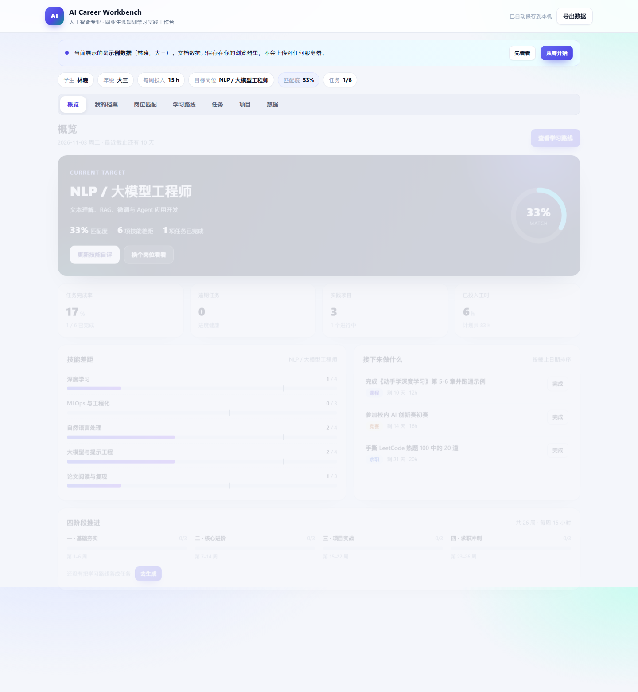

## 目录

- [为什么做这个](#为什么做这个)
- [功能一览](#功能一览)
- [在线体验](#在线体验)
- [快速开始](#快速开始)
- [桌面版](#桌面版)
- [使用流程](#使用流程)
- [核心设计](#核心设计)
- [界面截图](#界面截图)
- [目录结构](#目录结构)
- [测试](#测试)
- [部署到 GitHub Pages](#部署到-github-pages)
- [环境与兼容性](#环境与兼容性)
- [后续计划](#后续计划)
- [许可](#许可)

## 为什么做这个

人工智能专业的学生普遍面临三个问题：

1. **方向多、信息杂**：算法、CV、NLP/大模型、数据科学、MLOps、AI 产品、科研深造，每条路的技能栈不同，很难判断自己该补什么。
2. **规划停在纸面**：职业规划课给出的建议往往是"多实践、早准备"，缺少可执行到"这周做什么"的拆解。
3. **进展不可见**：学了很多课、做了几个项目，但说不清离目标岗位还差多少，简历上也讲不出量化结果。

这个工作台把上述问题收敛成一个可操作的工具：先做技能自评，再按目标岗位算出加权匹配度和差距清单，
自动生成 26 周四阶段学习路线，并把路线落成带截止日期的任务；日常在任务清单里推进、在项目台账里沉淀作品，
最后用数据看板复盘完成率、工时和技能画像。

## 功能一览

| 模块 | 能力 | 说明 |
| --- | --- | --- |
| 个人档案 | 姓名、年级、每周可投入时长、目标岗位 | 网页版修改即存，桌面版首次使用有三步向导 |
| 技能自评 | 13 项 AI 核心能力，0~5 分六级标准 | 未接触 / 了解概念 / 跟教程做过 / 独立完成课程项目 / 完整项目或实习 / 可指导他人 |
| 岗位图谱 | 7 类岗位，核心 3 分、重要 2 分、加分 1 分加权 | 输出 0~100% 匹配度排名与差距清单 |
| 学习路线 | 26 周四阶段：基础夯实、核心进阶、项目实战、求职冲刺 | 一键生成带截止日期的任务，自动去重 |
| 任务管理 | 增、删、完成、筛选、逾期提醒、工时统计 | 按截止日期排序，已完成置底 |
| 项目台账 | 项目名、技术栈、阶段、仓库链接、复盘备注 | 阶段：构思中 → 进行中 → 已完成 → 已上线 |
| 数据看板 | 完成率、分类进度、技能画像、项目分布、下一步建议 | 一眼看清当前状态 |
| 数据管理 | 自动保存、导出/导入 JSON、示例数据、清空 | 网页版存 localStorage，桌面版存文本文件 |

## 在线体验

部署地址：**https://yumgingg.github.io/ai-career-workbench/**

- 第一次打开会先弹出**欢迎页**：说明这是示例数据（林晓，大三），并给出三步用法；
- 点「从零开始」清空示例、填写自己的档案；点「先看看示例」直接体验完整界面；
- 所有数据只保存在你当前浏览器的 `localStorage`，不会上传到任何服务器；换设备前用「数据 → 导出 JSON」备份；
- **每个人的数据互相独立**：老师、同学打开同一链接时，看到的是各自浏览器里的数据，第一次打开都是示例，不会看到你的任务和项目。

不想用在线版也可以直接双击仓库根目录的 `index.html`，功能完全一样（无需服务器、无需联网）。
详细操作见 [使用指南](docs/使用指南.md)，或页面里的「指南」标签。

## 快速开始

### 网页版（推荐）

```bash
# 方式一：直接双击
index.html

# 方式二：本地起一个静态服务器（可选）
python -m http.server 8000
# 然后访问 http://127.0.0.1:8000/
```

### 桌面版（Windows x64）

```bat
:: 直接运行预编译程序
zysygh.exe

:: 或一键编译（需已安装 MinGW-w64）
build.bat
```

### 桌面版（源码编译，跨平台）

```bash
g++ -std=c++17 -O2 -o zysygh src/zysygh.cpp
./zysygh
```

> Windows 下建议加 `-static` 生成不依赖 MinGW 运行库的单文件程序：
> `g++ -std=c++17 -O2 -static -o zysygh.exe src/zysygh.cpp`

## 桌面版

网页版与桌面版共用同一套技能目录、岗位权重、匹配公式和路线规则，界面与交互各有取舍：

| 对比项 | 网页版 | 桌面版 |
| --- | --- | --- |
| 运行方式 | 浏览器打开，无需安装 | 双击 exe 或编译运行 |
| 界面 | 卡片式仪表盘、滑块自评、模态框 | 终端菜单与表格 |
| 数据存储 | 浏览器 localStorage | 当前目录 `workbench_data.txt` |
| 数据迁移 | 导出/导入 JSON | 复制文本文件 |
| 适合场景 | 演示、交作业链接、跨设备查看 | 课程设计要求、无浏览器环境 |

桌面版完整说明见 [docs/设计说明.md](docs/设计说明.md)。

## 使用流程

1. **填写档案**：姓名、年级、每周可投入小时数，选择目标岗位。
2. **技能自评**：13 项技能拉滑块打分，匹配度实时变化。
3. **看差距**：岗位匹配页按匹配度排名，点开任意岗位看逐项技能差距，可一键设为目标。
4. **生成路线**：学习路线页展示四阶段安排，点"一键生成阶段任务"落到任务清单（重复点击不会重复生成）。
5. **日常推进**：任务页新增/勾选/筛选，逾期任务会高亮提醒。
6. **沉淀项目**：项目页记录技术栈、阶段、链接与复盘，作为简历素材。
7. **每周复盘**：概览页看完成率、工时、技能差距和"接下来做什么"。

## 核心设计

### 岗位匹配度

对目标岗位的每项技能，按其权重 `w`（核心 3 / 重要 2 / 加分 1）加权：

```
匹配度 = Σ(w_i × 当前等级_i) / Σ(w_i × 5) × 100%
```

### 技能差距与路线生成

- 建议目标等级由权重决定：核心 → 4 分，重要 → 3 分，加分 → 2 分；
- 差距 = 建议目标 − 当前等级，按差距大小和权重排序；
- 阶段一（第 1–6 周）最多安排 4 项"从 0/1 分打基础"的技能，其余顺延到阶段二（第 7–14 周），避免 6 周内堆 7 门课；
- 阶段三（第 15–22 周）围绕权重最高的 3 项技能各做一个可展示项目；
- 阶段四（第 23–26 周）固定为简历、面试、投递复盘三项冲刺任务。

### 数据与界面

- **网页版**：单文件 `index.html`（HTML + CSS + 原生 JS，零依赖），状态集中在 `state` 对象，
  每次修改写入 `localStorage` 并即时重渲染；支持导出/导入 JSON 做备份与迁移。
- **桌面版**：`|` 分隔的 UTF-8 文本存档，逐行解析并校验字段；日期用公历序列号算法避免时区问题；
  中文按显示宽度对齐（CJK 记 2 格、ASCII 记 1 格）。
- 两端生成任务时都按"同技能 + 同分类"去重，重复生成不会产生副本。

更完整的设计说明见 [docs/设计说明.md](docs/设计说明.md)。

## 界面截图

### 网页版

| 概览 | 我的档案 |
| --- | --- |
|  | 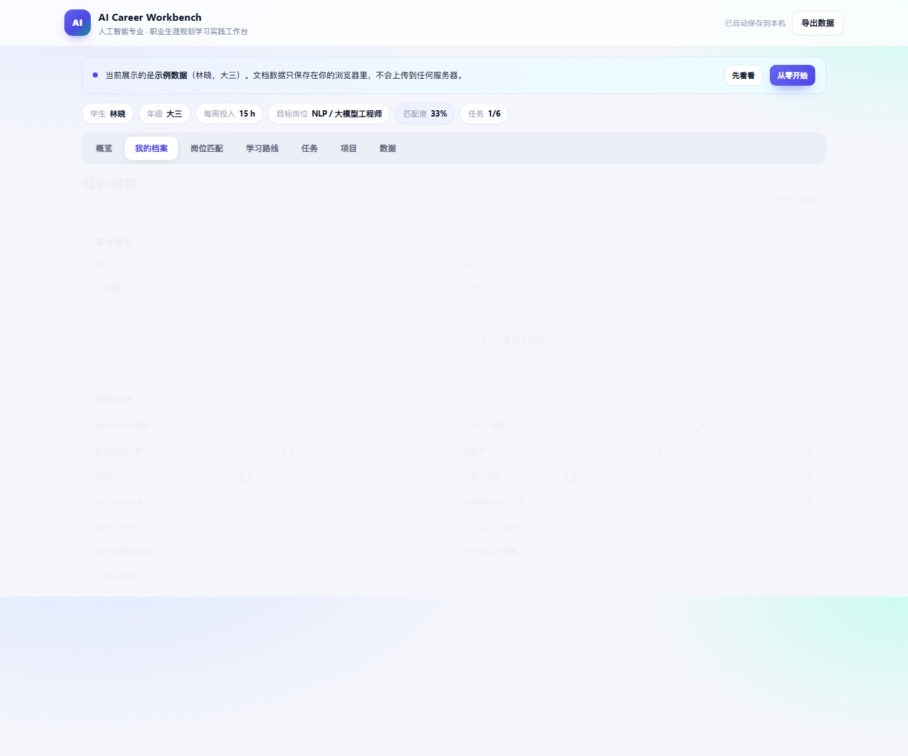 |

| 岗位匹配 | 学习路线 |
| --- | --- |
| 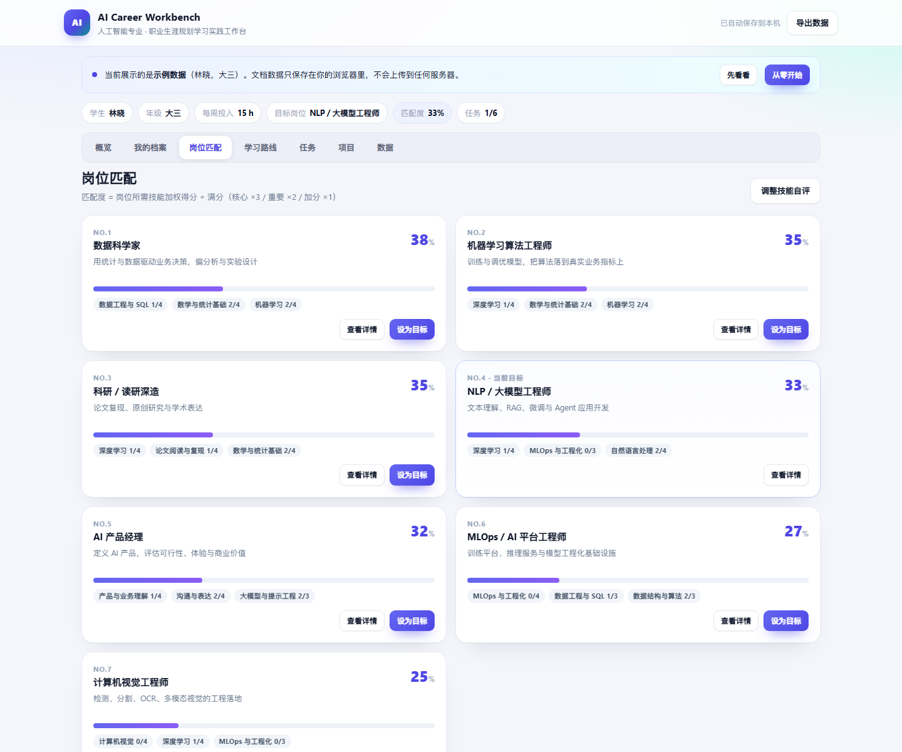 | 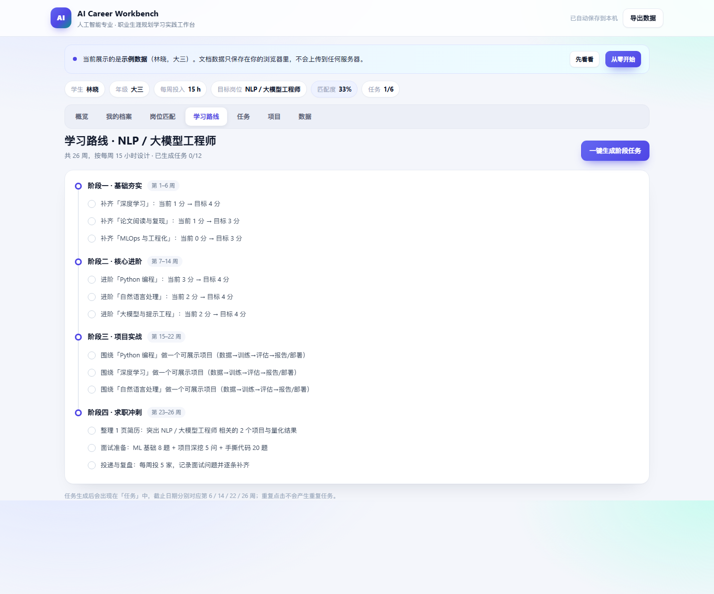 |

| 任务 | 项目 |
| --- | --- |
| 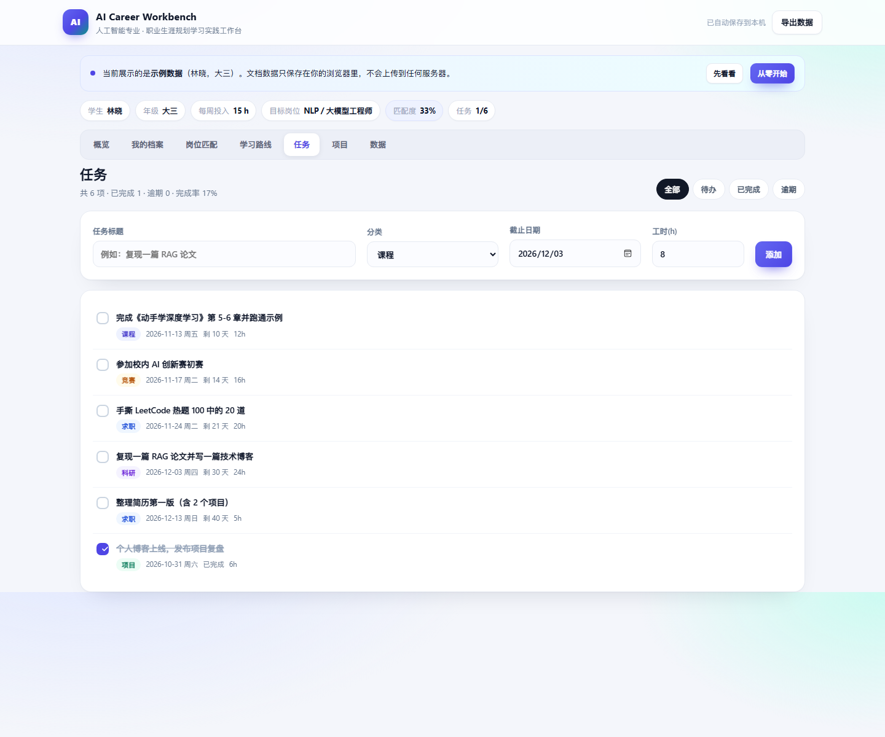 | 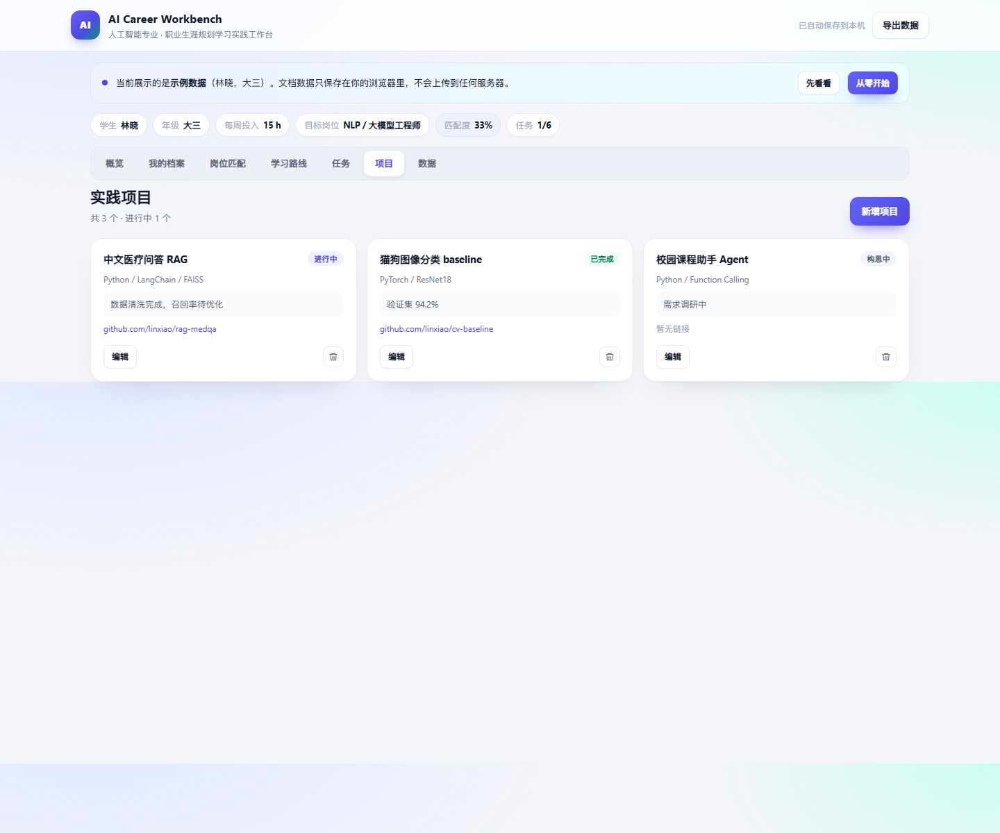 |

| 首次打开的欢迎页 | 操作指南 |
| --- | --- |
| 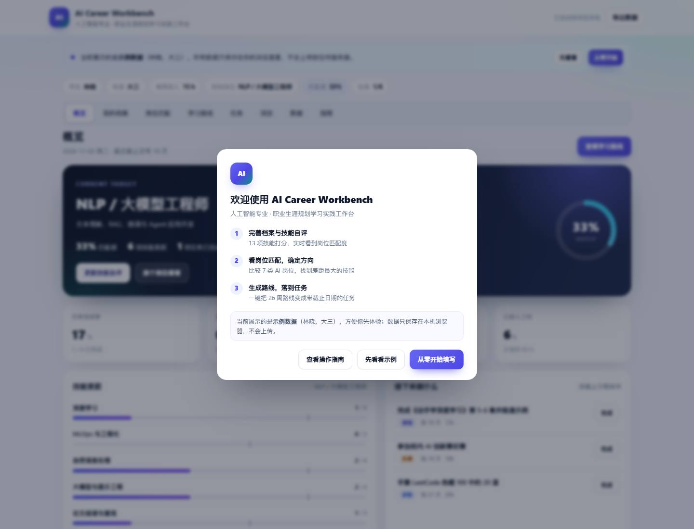 | 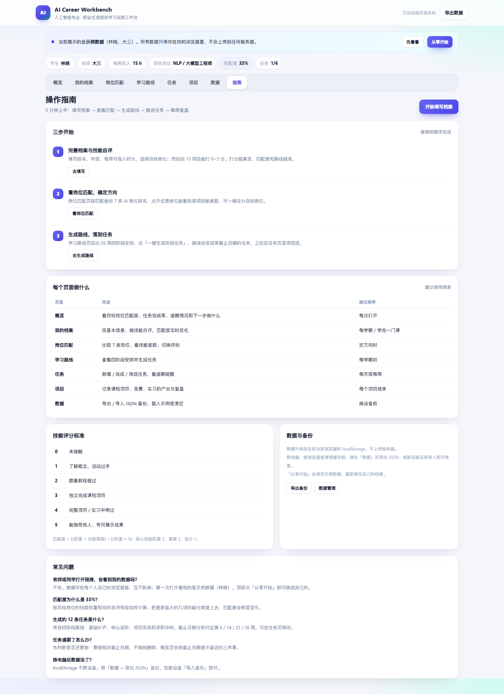 |

### 桌面版

| 岗位匹配 | 学习路线 |
| --- | --- |
| 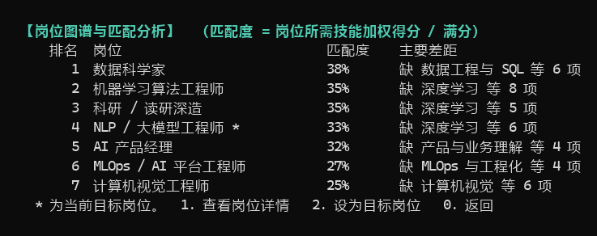 | 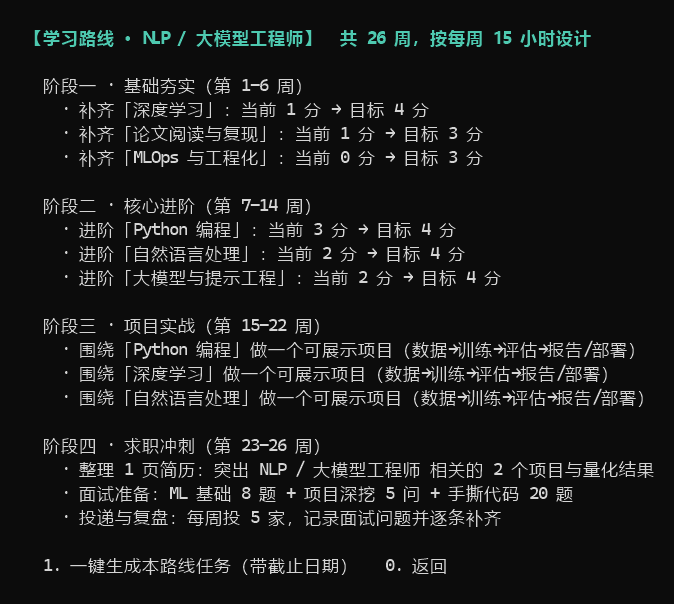 |

| 任务管理 | 数据看板 |
| --- | --- |
| 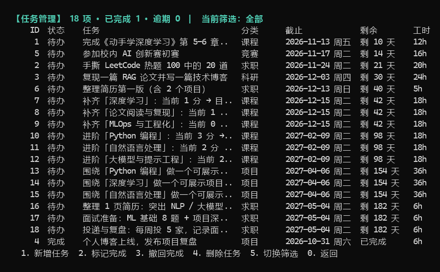 | 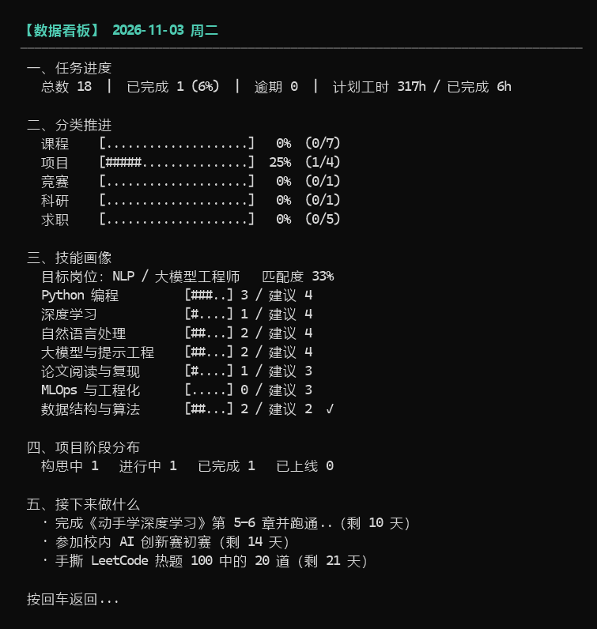 |

## 目录结构

```
ai-career-workbench/
├── index.html              # 网页版（单文件，零依赖）
├── src/
│   └── zysygh.cpp          # 桌面版全部源代码（单文件，约 1350 行）
├── docs/
│   ├── 使用指南.md          # 5 分钟上手说明与常见问题
│   ├── 设计说明.md          # 需求、模块、数据结构、算法、测试
│   └── 测试记录.md          # 测试用例与执行结果
├── screenshots/            # 网页版与桌面版界面截图
├── build.bat               # Windows 一键编译桌面版
├── run.bat                 # Windows 一键运行桌面版
├── Makefile                # Linux / macOS 构建
├── zysygh.exe              # Windows x64 预编译程序（静态链接）
├── LICENSE
└── README.md
```

## 测试

**桌面版**：12 组功能测试，覆盖首次向导、岗位匹配、路线生成与去重、任务全生命周期、项目台账、
看板统计、存档读档、非法输入与输入流结束，全部通过。

**网页版**：使用无头浏览器（Edge headless）实际打开页面并自动执行交互，验证结果：

| 用例 | 操作 | 结果 |
| --- | --- | --- |
| 初始渲染 | 打开页面 | 示例数据正常显示，任务 6 项 |
| 生成路线任务 | 点击"一键生成阶段任务" | 6 → 18 项，提示"已生成 12 条任务" |
| 重复生成 | 再次点击 | 仍为 18 项，无重复 |
| 岗位详情 | 打开"数据科学家"详情 | 模态框正常，内容匹配 |
| 新增任务 | 填写并提交表单 | 任务写入并出现在列表 |
| 勾选完成 | 点击复选框 | 完成数 1 → 2，样式同步 |
| 本地持久化 | 读取 localStorage | 19 项任务已保存，刷新不丢 |
| 首次欢迎页 | 清空浏览器存储后打开 | 欢迎弹窗出现，含三步说明与示例数据提示 |
| 欢迎页关闭 | 点「先看看示例」/「查看操作指南」 | 弹窗关闭，标记已读，跳转对应页面 |
| 操作指南页 | 打开「指南」标签 | 三步开始、页面说明、评分标准、FAQ 完整显示 |
| 从零开始 | 欢迎页点「从零开始填写」 | 档案清空（0 任务、姓名"同学"），示例提示条隐藏，刷新后仍隐藏 |
| 布局对齐 | 1440 / 1280 / 390px 设备模拟 | 头部、标签、内容区左边界一致，无横向滚动 |

测试中发现并修复的问题：

- 项目存档写出 7 个字段、读取却按 8 个字段校验，导致重启后项目记录丢失（桌面版）；
- 已完成任务仍显示"逾期 N 天"，两版均改为显示"已完成"；
- 技能分数变化后重复生成路线会产生重复任务，改为按"技能 + 分类"去重；
- 表格中文错位，桌面版实现 `displayWidth()` 按显示宽度对齐；
- 网页版头部与内容区宽度不一致，统一为 1180px 内容容器。

## 部署到 GitHub Pages

仓库根目录的 `index.html` 就是完整网页版，无需构建：

1. 把仓库推送到 GitHub；
2. 打开仓库 **Settings → Pages**；
3. **Source** 选择 `Deploy from a branch`，**Branch** 选 `main`、目录选 `/ (root)`，保存；
4. 等 1 分钟左右，访问 `https://<你的用户名>.github.io/ai-career-workbench/`。

国内访问 GitHub Pages 较慢时，也可以用 Gitee Pages 或任意静态托管（Netlify Drop、Vercel）直接拖入仓库目录。

## 环境与兼容性

- 网页版：现代浏览器（Chrome / Edge / Safari / Firefox），无网络依赖、无构建步骤；
- 桌面版：C++17，已验证 MinGW-w64 g++ 15.2.0（Windows 11），Linux/macOS 可用 g++ 或 clang++ 编译；
- 桌面版启动时自动切换 UTF-8 代码页，Windows Terminal / cmd 下中文正常显示。

## 后续计划

- [ ] 岗位 JD 关键词匹配：粘贴招聘描述，自动生成技能权重；
- [ ] 周计划视图：按周聚合任务，输出"本周三件事"；
- [ ] 导出 Markdown 简历素材与项目复盘模板；
- [ ] 网页版 PWA：离线可用、可添加到桌面；
- [ ] 数据层升级：支持多学期档案与历史对比。

## 许可

本项目采用 [MIT License](LICENSE)。
