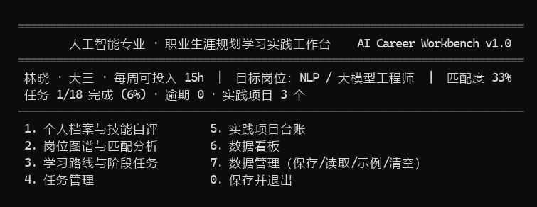

# AI Career Workbench

> 人工智能专业 · 职业生涯规划学习实践工作台
>
> 一个把「职业目标 → 技能差距 → 学习路线 → 任务执行 → 项目积累 → 数据复盘」串成闭环的
> 单文件 C++17 控制台程序，无第三方依赖，数据本地存档。



## 目录

- [为什么做这个](#为什么做这个)
- [功能一览](#功能一览)
- [快速开始](#快速开始)
- [使用流程](#使用流程)
- [核心设计](#核心设计)
- [界面截图](#界面截图)
- [目录结构](#目录结构)
- [测试](#测试)
- [环境与兼容性](#环境与兼容性)
- [后续计划](#后续计划)
- [许可](#许可)

## 为什么做这个

人工智能专业的学生普遍面临三个问题：

1. **方向多、信息杂**：算法、CV、NLP/大模型、数据科学、MLOps、AI 产品、科研深造，每条路的技能栈不同，很难判断自己该补什么。
2. **规划停在纸面**：职业规划课给出的建议往往是"多实践、早准备"，缺少可执行到"这周做什么"的拆解。
3. **进展不可见**：学了很多课、做了几个项目，但说不清离目标岗位还差多少，简历上也讲不出量化结果。

这个工作台把上述问题收敛成一个可操作的工具：先做技能自评，再按目标岗位算出加权匹配度和差距清单，
自动生成 26 周四阶段学习路线，并把路线落成带截止日期的任务；日常在任务清单里推进、在项目台账里沉淀作品，
最后用数据看板复盘完成率、工时和技能画像。所有数据写入本地文本文件，可随时备份、迁移。

## 功能一览

| 模块 | 能力 | 说明 |
| --- | --- | --- |
| 个人档案 | 姓名、年级、每周可投入时长、目标岗位 | 首次使用三步向导，之后随时修改 |
| 技能自评 | 13 项 AI 核心能力，0~5 分六级标准 | 未接触 / 了解概念 / 跟教程做过 / 独立完成课程项目 / 完整项目或实习 / 可指导他人 |
| 岗位图谱 | 7 类岗位，核心 3 分、重要 2 分、加分 1 分加权 | 输出 0~100% 匹配度排名与差距清单 |
| 学习路线 | 26 周四阶段：基础夯实、核心进阶、项目实战、求职冲刺 | 一键生成带截止日期的任务，自动去重 |
| 任务管理 | 增、删、完成、撤回、筛选、逾期提醒、工时统计 | 按截止日期排序，已完成置底 |
| 项目台账 | 项目名、技术栈、阶段、仓库链接、复盘备注 | 阶段：构思中 → 进行中 → 已完成 → 已上线 |
| 数据看板 | 完成率、分类进度条、技能画像、项目阶段分布、下一步建议 | 一眼看清当前状态 |
| 数据管理 | 保存、读取、示例数据、清空 | 纯文本存档，退出自动保存 |

## 快速开始

### 方式一：直接运行（Windows x64）

仓库根目录已附带静态编译的 `zysygh.exe`，双击即可；或在命令行运行：

```bat
zysygh.exe
```

### 方式二：一键编译（Windows，需已安装 MinGW-w64）

```bat
build.bat
```

### 方式三：手动编译（Windows / Linux / macOS）

```bash
g++ -std=c++17 -O2 -o zysygh src/zysygh.cpp
./zysygh
```

> 建议加 `-static`（Windows）生成不依赖 MinGW 运行库的单文件程序：
> `g++ -std=c++17 -O2 -static -o zysygh.exe src/zysygh.cpp`

程序的存档文件 `workbench_data.txt` 生成在**当前工作目录**，与可执行文件放在一起即可。

## 使用流程

1. **首次启动**：输入姓名、年级、每周可投入小时数，选择目标岗位；技能自评可跳过，之后在菜单 1 补填。
2. **摸清差距**：菜单 2 查看 7 类岗位的匹配度排名，选中岗位可看逐项技能差距，并把它设为目标岗位。
3. **生成路线**：菜单 3 查看四阶段路线，选择"一键生成任务"，会按阶段截止周全自动写入任务清单。
4. **日常推进**：菜单 4 新增/完成任务、切换筛选；逾期任务会在列表和看板中提示。
5. **沉淀作品**：菜单 5 记录每个实践项目的技术栈、阶段与复盘备注。
6. **每周复盘**：菜单 6 看完成率、工时、技能画像和"接下来做什么"。
7. **退出保存**：菜单 0 保存退出；数据管理里也可以手动保存、读取或载入示例数据体验。

菜单内所有输入处，方括号 `[x]` 表示默认值，直接回车即采用。

## 核心设计

### 岗位匹配度

对目标岗位的每项技能，按其权重 `w`（核心 3 / 重要 2 / 加分 1）加权：

```
匹配度 = Σ(w_i × 当前等级_i) / Σ(w_i × 5) × 100%
```

### 技能差距与路线生成

- 建议目标等级由权重决定：核心 → 4 分，重要 → 3 分，加分 → 2 分；
- 差距 = 建议目标 − 当前等级，按差距大小和权重排序；
- 阶段一（第 1–6 周）最多安排 4 项"从 0/1 分打基础"的技能，其余顺延到阶段二（第 7–14 周），避免 6 周内堆 7 门课；
- 阶段三（第 15–22 周）围绕权重最高的 3 项技能各做一个可展示项目；
- 阶段四（第 23–26 周）固定为简历、面试、投递复盘三项冲刺任务。

### 数据与界面

- 存档为 `|` 分隔的 UTF-8 纯文本，可读、可手改、可版本管理，读取时逐行解析并做字段校验；
- 日期使用公历序列号算法（Howard Hinnant 算法）计算天数差，避免时区与夏令时问题；
- 中文按显示宽度对齐（CJK 记 2 格、ASCII 记 1 格），表格在 Windows 终端下不会错位；
- 生成任务时按"同技能 + 同分类"去重，重复生成不会产生副本。

更完整的设计说明见 [docs/设计说明.md](docs/设计说明.md)。

## 界面截图

| 岗位匹配 | 学习路线 |
| --- | --- |
|  |  |

| 任务管理 | 数据看板 |
| --- | --- |
|  |  |

## 目录结构

```
ai-career-workbench/
├── src/
│   └── zysygh.cpp          # 全部源代码（单文件，约 1350 行）
├── docs/
│   ├── 设计说明.md          # 需求、模块、数据结构、算法、测试
│   └── 测试记录.md          # 测试用例与执行结果
├── screenshots/            # 界面截图
├── build.bat               # Windows 一键编译
├── run.bat                 # Windows 一键运行
├── Makefile                # Linux / macOS 构建
├── zysygh.exe              # Windows x64 预编译程序（静态链接）
├── LICENSE
└── README.md
```

## 测试

共 12 组功能测试，覆盖首次向导、岗位匹配、路线生成与去重、任务增删改查、项目台账、看板统计、
存档读档、非法输入与输入流结束等场景，全部通过。详细用例与结果见 [docs/测试记录.md](docs/测试记录.md)。

测试中发现并修复的典型问题：

- 项目存档写出 7 个字段、读取却按 8 个字段校验，导致重启后项目记录丢失；
- 已完成任务仍显示"逾期 N 天"，已改为显示"已完成"；
- 技能分数变化后重复生成路线会产生重复任务，已改为按"技能 + 分类"去重。

## 环境与兼容性

- 语言标准：C++17；
- 已验证编译器：MinGW-w64 g++ 15.2.0（Windows 11）；
- 终端：Windows Terminal / cmd（程序启动时自动切换 UTF-8 代码页）；
- 其他平台：Linux/macOS 可直接用 g++ 或 clang++ 编译，`Makefile` 已提供目标。

## 后续计划

- [ ] 岗位 JD 关键词匹配：粘贴招聘描述，自动生成技能权重；
- [ ] 周计划视图：按周聚合任务，输出"本周三件事"；
- [ ] 导出 Markdown 简历素材与项目复盘模板；
- [ ] 数据层切换 SQLite，支持多学期档案与历史对比；
- [ ] 简单的 Web 版（同一套数据模型），便于跨设备查看。

## 许可

本项目采用 [MIT License](LICENSE)。
